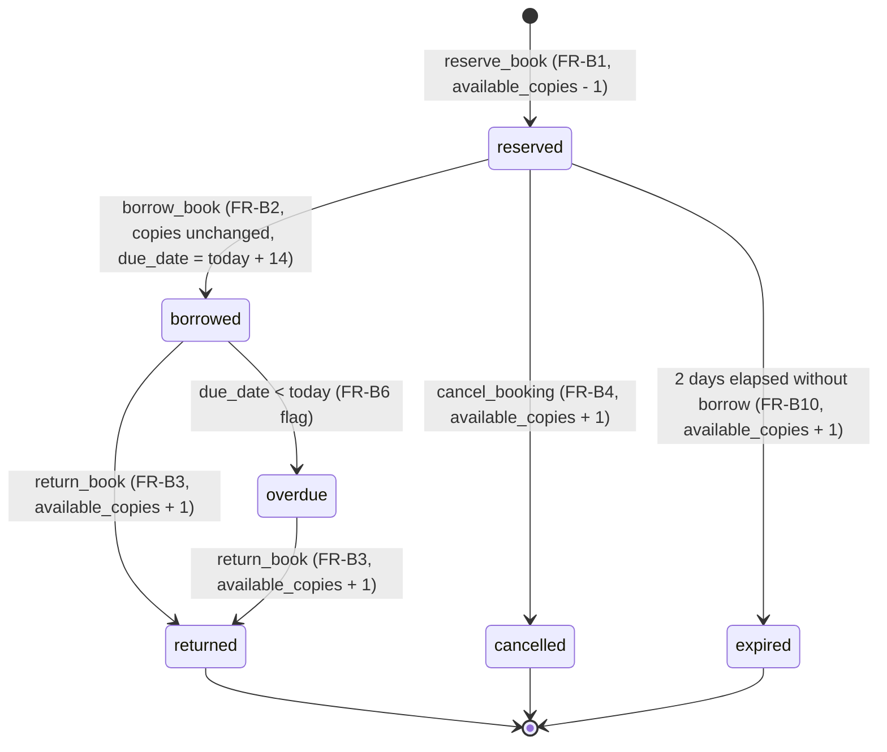

# Booking and Borrowing Rules

## Scope
Member 4 owns reservation and loan behaviour. Catalog owns book records; Member 3 owns users and authentication. Booking code must use their shared interfaces rather than create duplicate user, book, or availability tables.

## Requirements and Acceptance Criteria (DLBS-45 / Sprint 1)

| Requirement | Acceptance Criteria | Implementation / Verification |
|---|---|---|
| **Bookings Table Design** | Design table with columns: `id`, `user_id`, `book_id`, `status` (`reserved`, `borrowed`, `returned`, `cancelled`, `expired`), `reserved_at`, `expires_at`, `borrowed_at`, `due_date`, `returned_at`. | Implemented in `src/bookings/models.py` (`BookingRow`, `BookingTable`, and `Booking` dataclass) with SQLite/SQLAlchemy schema and check constraints. Verified by `test_dlbs_45_bookings_table_schema`. |
| **State Rules** | Strict state machine: `reserved -> borrowed`, `borrowed -> returned`, `reserved -> cancelled`, `reserved -> expired` (after 2 days). Any other transition is rejected. | Implemented in `src/bookings/rules.py` via `validate_status_transition`, raising `InvalidStateTransitionError`. Verified by `test_dlbs_45_allowed_state_transitions` and `test_dlbs_45_rejected_state_transitions`. |
| **Hold Expiry** | A reservation that is not borrowed within 2 days expires and restores the available copy. | Implemented via `calculate_hold_expiry` (2 days) and `BookingService.expire_booking`. Verified by `test_dlbs_45_hold_expiry_calculation` and `test_dlbs_45_service_expire_booking_restores_copy`. |
| **State Diagram** | State transition diagram added to `docs/`. | Visualized via Mermaid state diagram and ASCII lifecycle diagram below. |

## Requirements and Acceptance Criteria (DLBS-46 / Sprint 1)

| Requirement | Acceptance Criteria | Implementation / Verification |
|---|---|---|
| **FR-B1** | Booking created as `reserved` and available copies drop by one; a removed book is rejected. | `BookingService.reserve_book` atomically decrements `available_copies` by 1 and creates a booking record with status `reserved`. If `is_removed` is true, rejects with `BookRemovedError` / HTTP 409. |
| **FR-B9** | Reserving a book with 0 available copies returns 409 and changes nothing. | When `available_copies < 1`, transaction raises `NoCopiesAvailableError` / HTTP 409, rolls back, and leaves copies and bookings untouched. |
| **NFR-B1** | In a concurrent test exactly one reservation succeeds and available copies never go below 0. | Protected with atomic transactions (`BEGIN IMMEDIATE`) and locking. Verified with multi-threaded concurrent test (`test_nfr_b1_concurrent_reservations_single_copy`). |

## Requirements and Acceptance Criteria (DLBS-49 / Sprint 1)

| Requirement | Acceptance Criteria | Implementation / Verification |
|---|---|---|
| **FR-B2** | Status becomes `borrowed`, due date is 14 days after borrowing, available copies unchanged. | `BookingService.borrow_book` sets status to `borrowed` and `due_date = today + 14`. Does NOT modify `available_copies`. Verified by `test_tc_b01_*` and `test_api_borrow_copies_unchanged`. |
| **FR-B3** | Status becomes `returned` and available copies rise by one; returning a booking that is not borrowed is rejected. | `BookingService.return_book` sets status to `returned`, increments `available_copies + 1`. `ensure_can_return` rejects non-borrowed bookings. Verified by `test_tc_b03_*` and `test_api_return_non_borrowed_returns_409`. |
| **FR-B4** | Status becomes `cancelled` and available copies rise by one; a borrowed booking cannot be cancelled. | `BookingService.cancel_booking` sets status to `cancelled`, increments `available_copies + 1`. `ensure_can_cancel` rejects borrowed bookings. Verified by `test_tc_b05_*` and `test_api_cancel_borrowed_returns_409`. |
| **FR-B5** | Counts checked after every action in TC-B01, TC-B03, TC-B05 and TC-B08. | `test_tc_b08_counts_verified_after_every_action` performs reserve → borrow → return → re-reserve → cancel and asserts `available_copies` at each step. |

## Bookings Table Design (DLBS-45)

The `bookings` table manages reservation and loan lifecycles:

| Column Name | SQL Type | Nullable | Default | Description |
|---|---|---|---|---|
| `id` | `INTEGER` | `NOT NULL` | Auto-increment PK | Primary key |
| `user_id` | `INTEGER` | `NOT NULL` | — | Foreign key to `users.id` (ON DELETE CASCADE) |
| `book_id` | `INTEGER` | `NOT NULL` | — | Foreign key to `books.id` |
| `status` | `VARCHAR(20)` | `NOT NULL` | `'reserved'` | Current status (`reserved`, `borrowed`, `returned`, `cancelled`, `expired`) |
| `reserved_at`| `DATETIME` | `NOT NULL` | Current UTC | Timestamp when reservation was created |
| `expires_at` | `DATETIME` | `NULL` | +2 days | Timestamp when reservation hold expires if unborrowed |
| `borrowed_at`| `DATETIME` | `NULL` | — | Timestamp when loan began |
| `due_date` | `DATE` | `NULL` | +14 days | Due date for return |
| `returned_at`| `DATETIME` | `NULL` | — | Timestamp when book was returned |

Table Constraints:
- `CHECK (status IN ('reserved', 'borrowed', 'returned', 'cancelled', 'expired'))`

## State Transition Rules (DLBS-45)

```
                    +--------------------+
                    |    (New Booking)   |
                    +--------------------+
                               |
                               | [reserve]
                               v
                    +--------------------+
         +--------> |      RESERVED      | ---------+
         |          +--------------------+          |
         |                     |                    |
[after 2 days]                 | [borrow]       [cancel]
         |                     v                    |
         |          +--------------------+          |
         |          |      BORROWED      |          |
         |          +--------------------+          |
         |                     |                    |
         |                     | [return]           |
         v                     v                    v
+-----------------+ +--------------------+ +-----------------+
|     EXPIRED     | |      RETURNED      | |    CANCELLED    |
+-----------------+ +--------------------+ +-----------------+
 (Terminal state)      (Terminal state)     (Terminal state)
```

### State Machine Transition Matrix

| From State | To State | Trigger | Copy Count Impact | Allowed? |
|---|---|---|---|---|
| `[*] (None)` | `reserved` | `reserve_book` (FR-B1) | Decrement by 1 (`available_copies - 1`) | **Yes** |
| `reserved` | `borrowed` | `borrow_book` (FR-B2) | None (copies unchanged) | **Yes** |
| `reserved` | `cancelled` | `cancel_booking` (FR-B4) | Increment by 1 (`available_copies + 1`) | **Yes** |
| `reserved` | `expired` | `expire_booking` (FR-B10) | Increment by 1 (`available_copies + 1`) | **Yes** (after 2 days) |
| `borrowed` | `returned` | `return_book` (FR-B3) | Increment by 1 (`available_copies + 1`) | **Yes** |
| `reserved` | `returned` | Direct return attempt | — | **No** (Rejected) |
| `borrowed` | `cancelled` | Direct cancel attempt | — | **No** (Rejected) |
| `borrowed` | `expired` | Expire attempt on loan | — | **No** (Rejected) |
| `returned` | *Any* | Re-activation attempt | — | **No** (Terminal) |
| `cancelled` | *Any* | Re-activation attempt | — | **No** (Terminal) |
| `expired` | *Any* | Re-activation attempt | — | **No** (Terminal) |

### Mermaid State Diagram



## Business Rules

| ID | Rule |
|---|---|
| BR-01 | A signed-in member can reserve a book. |
| BR-02 | A reservation requires at least one available copy. |
| BR-03 | A member can have at most five active bookings (reserved + borrowed). |
| BR-04 | A reservation must identify one member and one book. |
| BR-05 | A reserved booking can be borrowed. |
| BR-06 | Borrowing sets the due date to 14 calendar days after the borrowing date. |
| BR-07 | Only a borrowed booking can be returned. |
| BR-08 | A return is processed once; repeated returns must not increase availability again. |
| BR-09 | Only a reserved booking can be cancelled. |
| BR-10 | A borrowed booking past its due date is overdue. |
| BR-11 | A cancelled, returned or expired booking is not active. |
| BR-12 | Concurrent requests for the final copy must not create two successful reservations. |
| BR-13 | Protected booking endpoints require the shared CurrentUser dependency. |

## Concurrency and Transaction Safety Strategy

To satisfy **NFR-B1**, **FR-B1**, and **FR-B9**:
- SQLite database transactions use `BEGIN IMMEDIATE` and an internal re-entrant mutex (`RLock`) ensuring serialized execution of reservation and availability updates.
- The `books` table enforces a database constraint `CHECK(available_copies >= 0)` preventing underflow at the storage layer.
- `UPDATE books SET available_copies = available_copies - 1 WHERE id = ? AND available_copies > 0` verifies that only positive stock is decremented.
- Any business rule violation triggers an immediate `ROLLBACK`, guaranteeing that availability counts and booking records remain strictly unchanged.

## Integration Agreements

- User IDs and authentication come from `src/users/auth.py` (`CurrentUser`).
- Book IDs and `available_copies` come from Member 2's catalog.
- Only one component should decrement/increment `available_copies`; booking service owns availability updates for reservations, returns, and cancellations.
- Persistence/session conventions match the app's shared database setup (`sqlite3` / SQLAlchemy).
- Use integer IDs, snake_case JSON, UTC ISO 8601 timestamps and `{"detail": "..."}` errors.
- Use HTTP 409 for unavailable copies or invalid booking-state conflicts; 401 for missing/invalid authentication; 404 for missing resources; 422 for malformed input.
