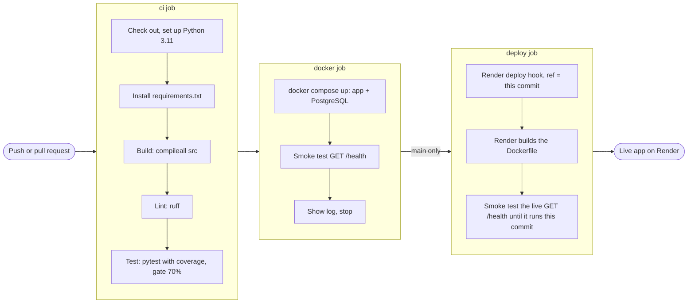

# CI/CD pipeline

Owner: Member 3. The pipeline is one GitHub Actions workflow,
[`.github/workflows/ci.yml`](../.github/workflows/ci.yml), with three jobs. Every push
and pull request is built, linted, tested and run in Docker; every merge to `main` is
deployed to Render and checked on the live site. Setup steps for Render and the GitHub
secret are in [`.github/workflows/README.md`](../.github/workflows/README.md).

## Overview



A job starts only if the job before it passed, so a commit that fails its tests is
never built into an image, and an image that does not start is never deployed.

| Job | Runs on | Fails when |
|---|---|---|
| `ci` | every push to any branch, every pull request | the code does not compile, ruff finds a problem, a test fails, or coverage of `src/` is below 70% |
| `docker` | every push to any branch, every pull request | the image does not build, the app does not start with PostgreSQL, or `/health` does not answer `{"status": "ok"}` |
| `deploy` | a merge to `main`, or **Run workflow** on `main` | Render cannot be asked to deploy, or the live `/health` does not answer from the new commit within 20 minutes |

## ci: build, lint and test

| Step | Command |
|---|---|
| Build | `python -m compileall -q src` |
| Lint | `ruff check --line-length 100 --select E,F,W,I .` |
| Test | `pytest --cov=src --cov-report=term-missing --cov-report=xml --cov-fail-under=70` |

The coverage gate is `COVERAGE_GATE` at the top of the job. It started at 50% on 5 Nov,
so that a module with fewer tests did not block everyone early, and went up to 70% on
7 Nov. Total coverage on 7 Nov is 97%.

Each run's **Summary** page shows a coverage table per file, and `coverage.xml` is
saved under **Artifacts** for 14 days.

## docker: the image and the database together

`docker compose up --build --wait` builds the `Dockerfile` and starts it next to a
PostgreSQL 16 container (`docker-compose.yml`). The job then runs
`scripts/smoke_test.py`, which calls `GET /health` until it answers `{"status": "ok"}`
with this commit in the `X-App-Version` header. This catches problems that SQLite in the
tests cannot: on 6 Nov it showed that 6 books had author lists longer than the
`author` column, which SQLite had accepted.

The container (`python -m scripts.start`) creates the tables, starts the app at once and
loads the books in the background (`SEED_BOOKS=full`: 10,000 books in about a minute).
Books that are already there are skipped, so a restart takes under a second.

## deploy: Render

| Piece | Where it is kept |
|---|---|
| Deploy hook URL (lets anyone who has it redeploy) | GitHub secret `RENDER_DEPLOY_HOOK_URL` |
| Address of the live app | GitHub variable `APP_URL` |
| Database URL, `JWT_SECRET`, admin login, `SEED_BOOKS` | Render environment variables |

No token or password is in the code. Until the secret and the variable exist, the job
shows a warning and deploys nothing.

1. The job calls the deploy hook with `ref=<commit>`, so Render builds exactly the
   commit that passed `ci` and `docker`. Render's own auto-deploy is off.
2. Render builds the `Dockerfile` and swaps the new version in when it starts.
3. `scripts/smoke_test.py` calls the live `GET /health` every 20 seconds. The old
   version keeps answering during the build, so the test waits until `X-App-Version`
   (Render sets `RENDER_GIT_COMMIT`) names the new commit. If that has not happened
   within 20 minutes, the job and the run fail.

To deploy `main` again without a new merge: **Actions** → **CI** → **Run workflow** →
`main`. To undo a bad deploy, revert its pull request on GitHub; merging the revert
deploys the previous code through the same checks.

## Rules around the pipeline

- `main` is protected: changes arrive only through pull requests, each needs one
  approval, and the `ci` check must pass before merging.
- Branches are named `feature/<JIRA-KEY>-short-name`, and every commit message starts
  with the Jira key.
- Code freeze is 7 Nov. After it, only fixes are merged, and each still goes through
  the whole pipeline.

## Running the same checks locally

```bash
ruff check --line-length 100 --select E,F,W,I .
pytest --cov=src --cov-report=term-missing --cov-fail-under=70
docker compose up --build --wait
python scripts/smoke_test.py http://localhost:8000
docker compose down --volumes
```

## For the presentation

- **The pipeline:** a run on the **Actions** tab shows the three jobs as a graph. Open
  a green run on `main` to show `ci` → `docker` → `deploy`.
- **Coverage:** the same run's **Summary** page has the coverage table per file.
- **The deploy:** the `deploy` job's last step prints the live `/health` answer with the
  commit that is running.
- **The badge:** the badge at the top of the README shows the latest result on `main`.
- **Before the demo:** open the live app a few minutes early. A free Render service
  sleeps after 15 minutes without visitors and takes about a minute to wake.
