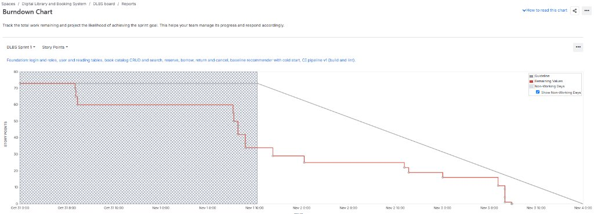
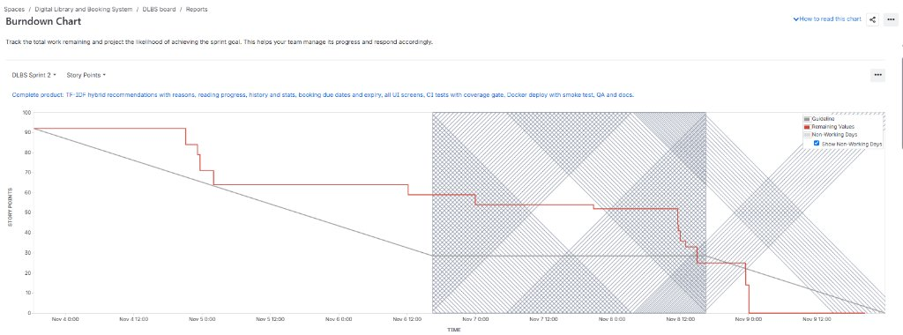
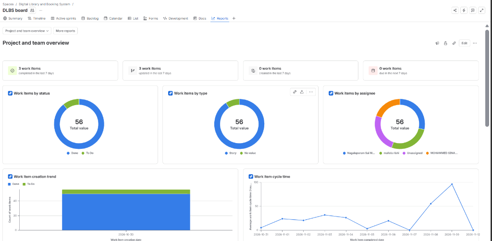
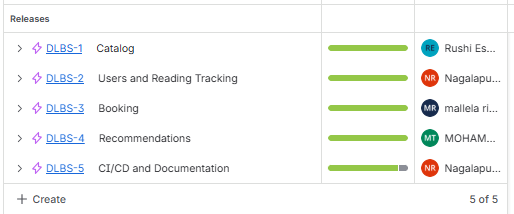
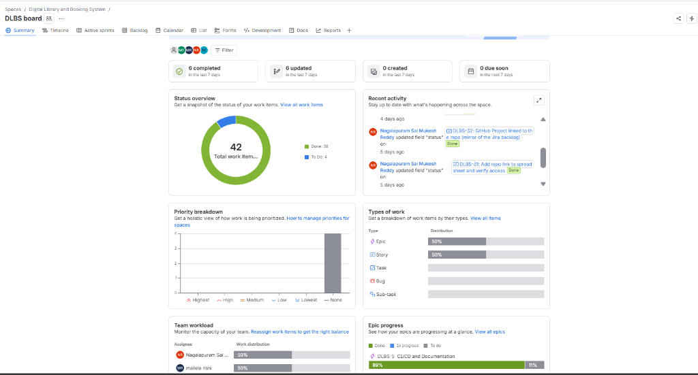

# Project Management & Jira Metrics Screenshots

This directory contains the Jira agile tracking, burndown charts, and release progress dashboards for the **Digital Library and Booking System (DLBS)** project.

---

## Index of Screenshots

| Screenshot | Description | Key Metrics / Milestone |
|---|---|---|
| [`sprint-1-burndown-chart.jpg`](sprint-1-burndown-chart.jpg) | **Sprint 1 Burndown Chart** (Oct 31 – Nov 3, 2026) | 73 Story Points completed down to 0; Foundation deliverables (Catalog CRUD, Auth & Roles, Booking base, Baseline Recommender, CI build/lint). |
| [`sprint-2-burndown-chart.jpg`](sprint-2-burndown-chart.jpg) | **Sprint 2 Burndown Chart** (Nov 4 – Nov 9, 2026) | 92 Story Points completed down to 0; Feature completion (TF-IDF Hybrid Recommendations, Reading tracking, Due dates/expiry, UI screens, Docker deployment, CI tests & 70% coverage gate). |
| [`jira-project-and-team-overview.png`](jira-project-and-team-overview.png) | **Project and Team Overview Report** | Donut distribution by Status (Done vs To Do), Type (Story), and Assignee (Nagalapuram Sai Mukesh, Mallela Rishi, Mohammed Sinan, Unassigned), plus cycle time and creation trends. |
| [`jira-epics-and-releases-progress.png`](jira-epics-and-releases-progress.png) | **Epics & Releases Progress** | High-level progress across all 5 project Epics: DLBS-1 (100%), DLBS-2 (100%), DLBS-3 (100%), DLBS-4 (100%), DLBS-5 (89%). |
| [`jira-board-summary-and-metrics.png`](jira-board-summary-and-metrics.png) | **DLBS Board Summary & Workload** | 42 Total work items (38 Done, 4 To Do), priority distribution, work type breakdown (50% Epic, 50% Story), and balanced team workload allocation. |

---

## Detailed Views

### 1. Sprint 1 Burndown Chart
> **Sprint Goal:** Foundation: login and roles, user and reading tables, book catalog CRUD and search, reserve, borrow, return and cancel, baseline recommender with cold start, CI pipeline v1 (build and lint).

---

### 2. Sprint 2 Burndown Chart
> **Sprint Goal:** Complete product: TF-IDF hybrid recommendations with reasons, reading progress, history and stats, booking due dates and expiry, all UI screens, CI tests with coverage gate, Docker deploy with smoke test, QA and docs.

---

### 3. Project and Team Overview
> Comprehensive dashboard tracking 56 total work items by status, issue type, and individual team member contributions, along with issue cycle times across the sprint timeline.

---

### 4. Epics & Releases Progress
> Epic tracking across all five core modules:
> - **DLBS-1:** Catalog (100%)
> - **DLBS-2:** Users and Reading Tracking (100%)
> - **DLBS-3:** Booking (100%)
> - **DLBS-4:** Recommendations (100%)
> - **DLBS-5:** CI/CD and Documentation (89%)

---

### 5. DLBS Board Summary & Team Workload
> Live board summary snapshot displaying work item breakdown (38 Done, 4 To Do), recent team updates, and 50/50 balance between epics and user stories.

